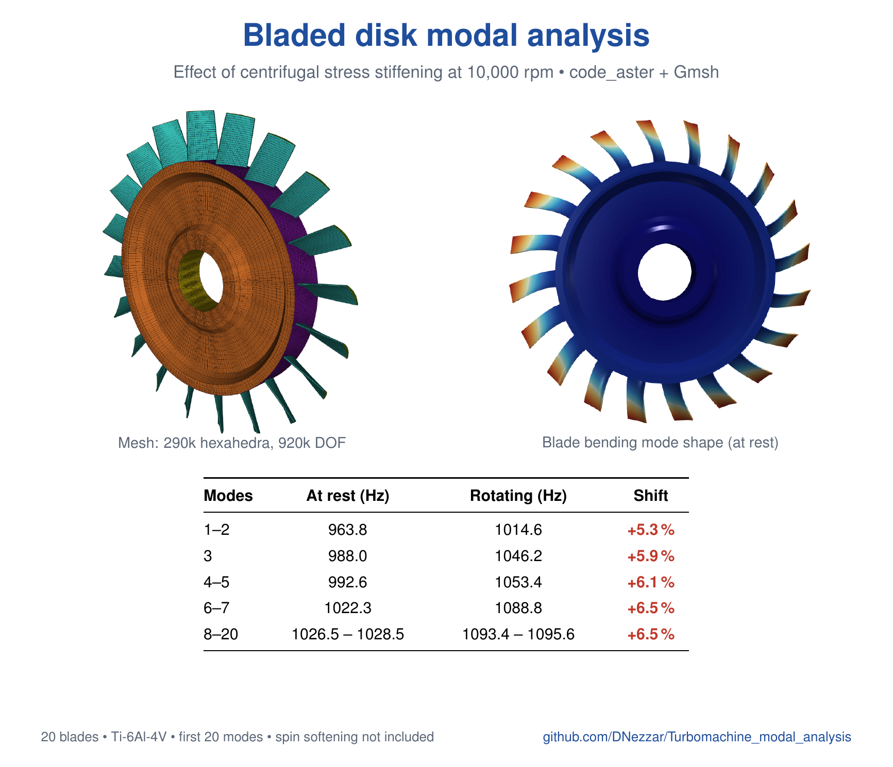

# Turbomachine modal analysis

Modal analysis of an integrally bladed disk (disk + 20 blades) with
[code_aster](https://code-aster.org), at rest and in rotation, to measure the
effect of centrifugal stress stiffening on the natural frequencies.



## Contents

| File | Purpose |
|---|---|
| `roue_aubagee.py` | Generates the parametric all-HEXA8 mesh (Gmsh + NumPy) |
| `roue_aubagee.med` | Generated mesh (Git LFS) |
| `modal_roue.comm` | code_aster command file |
| `modal_roue.export` | `run_aster` launch file |
| `modal_roue.resu` | Table of natural frequencies |
| `modal_roue.mess` | Solver log |
| `modal_roue.rmed` | Result fields: static solution and mode shapes (Git LFS, 704 MB) |
| `note/note_modale.pdf` | Short technical note, in French (LaTeX source in `note/`) |

## Model

- Full 360° wheel, rotation axis Z, units mm / t / s.
- 289,440 HEXA8 elements, 316,481 nodes, 919,440 active degrees of freedom.
- Ti-6Al-4V: E = 110 GPa, ν = 0.31, ρ = 4430 kg/m³.
- A `CENTRE` node on the axis (6 degrees of freedom) is tied to the bore and
  then clamped. The tie is either rigid (`LIAISON_SOLIDE`) or distributing
  (`RBE3`), selected in the `.comm` file.
- Rotation is applied as a centrifugal body load (`ROTATION`), here
  10,000 rpm.

## Analysis

1. Linear static analysis under centrifugal load, which gives the preload
   stress field.
2. Assembly of K, M and the geometric stiffness Kg.
3. Two modal analyses: K alone (at rest) and K + Kg (rotating).

Spin softening (`RIGI_ROTA`) is off by default (`ASSOUPLISSEMENT = False` in
the `.comm` file). Gyroscopic effects are not included.

## Results

The first 20 modes form a complete family (nodal diameters 0 to 10).

| Modes | At rest (Hz) | Rotating (Hz) | Shift |
|---|---|---|---|
| 1–2 | 963.8 | 1014.6 | +5.3 % |
| 3 | 988.0 | 1046.2 | +5.9 % |
| 4–5 | 992.6 | 1053.4 | +6.1 % |
| 6–20 | 1022.3 to 1028.5 | 1088.8 to 1095.6 | +6.5 % |

Details and the cross-check against Southwell's law are in
[the note](note/note_modale.pdf).

## Usage

Fetch the LFS files after cloning:

```bash
git lfs install
git lfs pull
```

Regenerate the mesh (Python with `gmsh` and `numpy`):

```bash
python3 roue_aubagee.py          # add --gui to view it
```

Run the analysis (code_aster 17, about 5 GB of memory):

```bash
run_aster modal_roue.export
```
