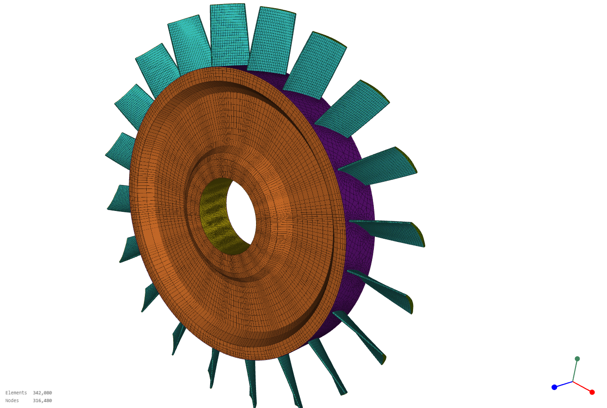

# Turbomachine modal analysis

Analyse modale d'une roue aubagée monobloc (disque + 20 pales) avec
[code_aster](https://code-aster.org), à l'arrêt et en rotation, pour mesurer
l'effet du raidissement centrifuge (*stress stiffening*).



## Contenu

| Fichier | Rôle |
|---|---|
| `roue_aubagee.py` | Génère le maillage paramétrique 100 % HEXA8 (Gmsh + NumPy) |
| `roue_aubagee.med` | Maillage généré (Git LFS) |
| `modal_roue.comm` | Fichier de commandes code_aster |
| `modal_roue.export` | Fichier de lancement `run_aster` |
| `modal_roue.resu` | Table des fréquences propres |
| `modal_roue.mess` | Journal du calcul |
| `modal_roue.rmed` | Champs résultats : statique et déformées modales (Git LFS, 704 Mo) |
| `note/note_modale.pdf` | Note de synthèse (source LaTeX dans `note/`) |

## Modèle

- Roue complète 360°, axe de rotation Z, unités mm / t / s.
- 289 440 HEXA8, 316 481 nœuds, 919 440 degrés de liberté actifs.
- Matériau TA6V : E = 110 GPa, ν = 0,31, ρ = 4430 kg/m³.
- Un nœud `CENTRE` sur l'axe (6 degrés de liberté) est lié à l'alésage puis
  encastré. La liaison est rigide (`LIAISON_SOLIDE`) ou répartie (`RBE3`),
  au choix dans le `.comm`.
- La rotation est un chargement centrifuge (`ROTATION`), ici 10 000 tr/min.

## Calcul

1. Statique linéaire sous chargement centrifuge, qui donne les contraintes de
   précharge.
2. Assemblage de K, M et de la raideur géométrique Kg.
3. Deux analyses modales : K seul (arrêt) et K + Kg (rotation).

L'assouplissement centrifuge (`RIGI_ROTA`) est désactivé par défaut
(`ASSOUPLISSEMENT = False` dans le `.comm`). Les effets gyroscopiques ne sont
pas pris en compte.

## Résultats

Les 20 premiers modes forment une famille complète (diamètres nodaux 0 à 10).

| Modes | À l'arrêt (Hz) | En rotation (Hz) | Écart |
|---|---|---|---|
| 1–2 | 963,8 | 1014,6 | +5,3 % |
| 3 | 988,0 | 1046,2 | +5,9 % |
| 4–5 | 992,6 | 1053,4 | +6,1 % |
| 6–20 | 1022,3 à 1028,5 | 1088,8 à 1095,6 | +6,5 % |

Le détail et le recoupement avec la loi de Southwell sont dans
[la note](note/note_modale.pdf).

## Utilisation

Récupérer les fichiers LFS après le clone :

```bash
git lfs install
git lfs pull
```

Régénérer le maillage (Python avec `gmsh` et `numpy`) :

```bash
python3 roue_aubagee.py          # ajouter --gui pour visualiser
```

Lancer le calcul (code_aster 17, environ 5 Go de mémoire) :

```bash
run_aster modal_roue.export
```
